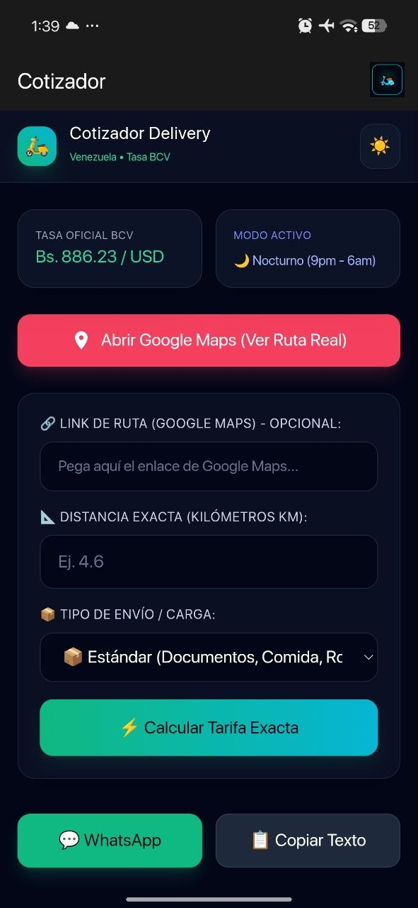
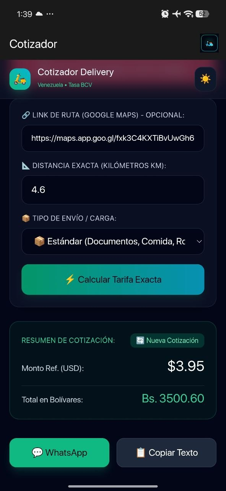
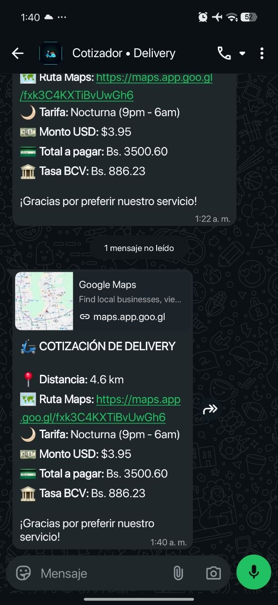

# 🛵 Cotizador de Delivery Venezuela

> **Tu aliado perfecto para calcular tarifas de delivery de forma exacta, rápida y transparente.**

---

## 📲 Capturas de la Aplicación

| Interfaz Nativa | Cálculo de Tarifa | Integración WhatsApp |
| :---: | :---: | :---: |
|  |  |  |

---

## ⚡ Características Principales

* 🏛️ **Tasa BCV en Tiempo Real:** Actualización automática mediante API oficial para conversión exacta a Bolívares.
* 🌙 **Detección Nocturna Automática:** Aplica el recargo automático entre 9:00 PM y 6:00 AM.
* 📦 **Multiplicadores de Cargas Especiales:** Opciones para envíos estándar, carga pesada/voluminosa (+25%) u objetos frágiles (+15%).
* 🗺️ **Acceso Directo a Google Maps:** Apertura limpia e inmediata para verificar rutas en tiempo real.
* 💬 **Integración Nativa con WhatsApp:** Genera una plantilla clara lista para enviar al cliente en un toque.
* 🔄 **Botón "Nueva Cotización":** Reinicia todos los campos al instante para agilizar el trabajo diario.

---

## 🛠️ Regla de Tarifas Aplicada

| Concepto | Valor |
| :--- | :--- |
| **Tarifa Base (Primeros 2 km)** | $2.00 USD |
| **Kilómetro Adicional** | $0.40 USD / km |
| **Recargo Carga Pesada** | +25% |
| **Recargo Objeto Frágil** | +15% |
| **Recargo Horario Nocturno** | +30% |

---

## 🌐 Probar la Herramienta

Puedes acceder a la versión ejecutable o descargar la aplicación nativa APK para Android desde el enlace oficial:

👉 **[Abrir Cotizador / Descargar APK](https://herggiediaz.github.io/cotizador-delivery/)**

---
*Desarrollado para optimizar el trabajo diario de repartidores y servicios de encomienda en Venezuela.*
